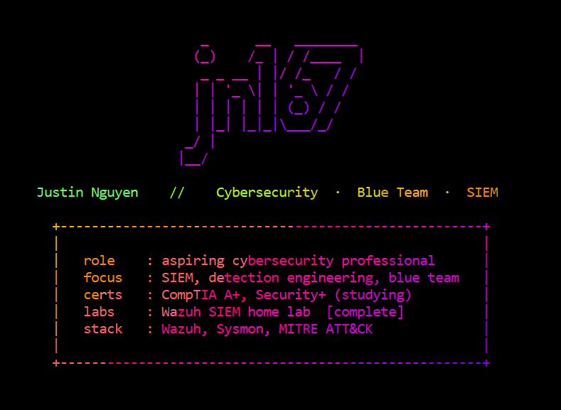

  

# Justin Nguyen

**Computer Science Graduate | IT & Cybersecurity | CompTIA A+ & Security+ in progress**

B.S. Computer Science, University of North Texas

Based in the Dallas / Fort Worth area. I'm building toward a career in IT and cybersecurity, with a background in full-stack software development.

> [!NOTE]
> Currently building a hands-on cybersecurity home lab series and studying for CompTIA Security+. The first lab, a Wazuh SIEM with custom MITRE-mapped detections, is complete, see the roadmap below.

---

## 🚀 Featured Project

### [SIEM & Log Analysis Home Lab](https://github.com/jn167/siem-log-analysis-lab)
A hands-on Wazuh SIEM on an isolated virtual network. Windows and Linux endpoints forward telemetry to the SIEM, I run safe attacker simulations against my own machines, and five custom MITRE ATT&CK mapped rules catch each technique. Every detection is written up analyst-style: what fired, what actually happened, and what to do about it.

| | |
| --- | --- |
| **SIEM** | Wazuh 4.14 (manager, indexer, dashboard) |
| **Endpoints** | Windows 11 with Sysmon, Ubuntu 24.04, Kali Linux attacker |
| **Detections** | 5 custom rules, validated against live simulated attacks |
| **Highlights** | SSH brute force detected end to end, custom SOC overview dashboard |
| **Repo** | [siem-log-analysis-lab](https://github.com/jn167/siem-log-analysis-lab) |

---

## 🔐 Security Lab Roadmap

A series of hands-on home labs to build practical blue-team and offensive security skills. Each lab gets its own repo with setup notes, screenshots, and write-ups.

| # | Lab | Focus | Status |
| --- | --- | --- | --- |
| **1** | **[SIEM & Log Analysis](https://github.com/jn167/siem-log-analysis-lab)** | **Wazuh, log ingestion, custom detection rules, dashboards** | **Complete** |
| 2 | [Network Traffic Analysis](https://github.com/jn167/network-traffic-analysis-lab) | Packet capture and analysis with Wireshark, plus Suricata and Zeek IDS | In progress |
| 3 | Vulnerability Scanning | Scanning a test network, prioritizing findings | Planned |
| 4 | Incident Response Practice | Simulated incident, timeline, and write-up | Planned |
| 5 | Active Directory Home Lab | Building a small AD domain, then studying common attacks | Planned |

---

## 💻 Other Projects

### UNT Marketplace
A full-stack marketplace web app for the UNT community, built as a group senior project during my final year at the University of North Texas.

| | |
| --- | --- |
| **Stack** | Next.js, TypeScript, PostgreSQL |
| **Auth** | better-auth |
| **Testing** | Playwright end-to-end tests |
| **CI** | GitHub Actions |
| **Repo** | [UNT-Marketplace](https://github.com/CSCE-4901-Gold-Team/UNT-Marketplace) |

---

## 🧠 Skills

**Languages:** `TypeScript` `JavaScript` `SQL` `Python`  
**Web:** `Next.js` `React` `PostgreSQL` `REST APIs`  
**Tools:** `Git` `GitHub Actions` `Playwright` `Linux`  
**Security:** `Wazuh (SIEM)` `Sysmon` `MITRE ATT&CK` `Detection Engineering`  
**Learning:** `Networking` `Security Fundamentals` `Incident Response`

---

## 📜 Certifications

- CompTIA A+ (in progress)
- CompTIA Security+ (in progress)

---

## 📫 Connect

- [LinkedIn](https://www.linkedin.com/in/justin-nguyen-1a804a293/)
- Email: [jmnguyenbiz@gmail.com](mailto:jmnguyenbiz@gmail.com)
